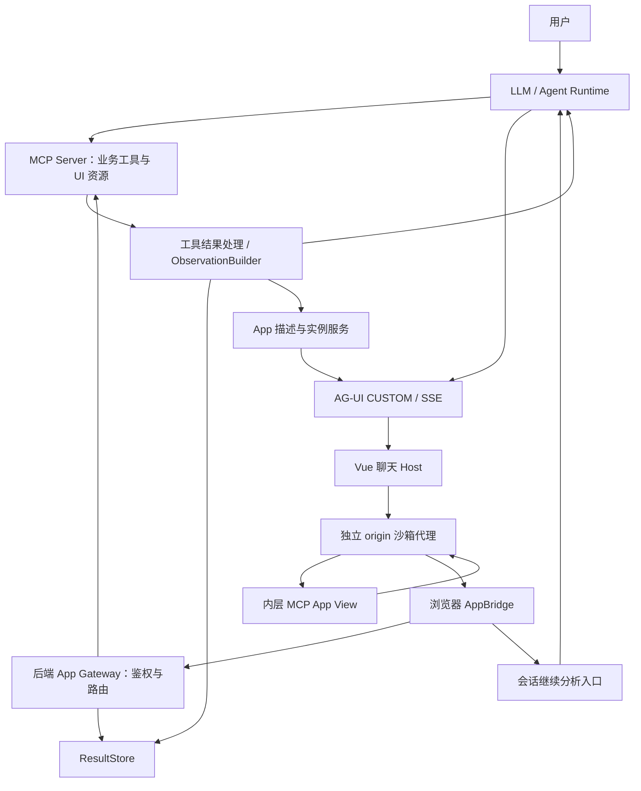
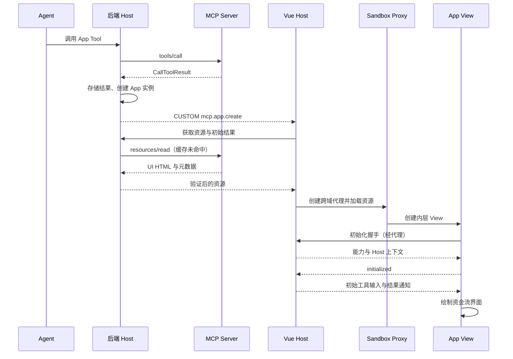

# 富可视化流式响应第三阶段实施设计

## 1. 文档定位与实施目标

本文细化《[LLM + MCP 富可视化流式响应技术方案](./LLM%20+%20MCP%20富可视化流式响应技术方案.md)》第 51 节的第三阶段，并落实第 34、35 节的 MCP App Tool 设计。

第三阶段在现有文本流、Vue Renderer、ResultStore 和富 UI 事件机制上，增加由 MCP Server 提供的专属交互应用，实现：

1. Assistant 消息中同时展示流式文字、平台组件和 MCP App。
2. MCP App 内的筛选、节点展开、分页等操作能够再次查询业务数据。
3. 用户在 App 中发起“继续分析”，能够启动 Agent 新一轮流式回答。
4. App 的权限、数据访问、资源版本、生命周期和历史恢复由平台统一管理。

首个端到端样例采用资金流分析 App；随后扩展高交互证据链和复杂时序分析。普通表格、统计图和已有证据链 Renderer 继续走现有组件路径，只有需要专属工作区的能力才绑定 MCP App。

本文是实施设计，新增类名、接口、事件及参数均为建议契约，不能视为已实现功能。现状依据本仓库源文件静态检查；未通过本文宣称现有运行时已经完成 MCP Apps 兼容认证。

## 2. MCP Apps 在本项目中的含义

### 2.1 谁提供界面

MCP App 开发者编写界面，MCP Server 提供工具和关联的 UI 资源；平台作为 Host 加载、展示并代理交互。MCP Apps 是这套机制的协议扩展，不会自动生成业务界面。[参考：官方概览](https://apps.extensions.modelcontextprotocol.io/api/documents/Overview.html)

| 参与方 | 责任 | 本项目落点 |
|---|---|---|
| 业务 App 开发者 | 实现资金图、筛选器、详情面板及业务交互 | 建议新增 `apps/fund-flow-app` |
| MCP Server | 发布工具定义、UI 资源及业务查询能力 | `mcp-server` |
| 后端 Host | 管理 MCP 连接、资源获取、App 会话及权限 | 公共 App 服务 + 两套 client 接入 |
| 浏览器 Host | 创建沙箱、建立桥接、展示 App、组织聊天消息 | `packages/agent-ui`、`frontend` |
| Agent Runtime | 决定是否展示 App、组织解释、接受后续分析请求 | SAA / AgentScope 适配器 |

App 可以内部使用 Vue、ECharts 或 G6，但交付物是独立的 HTML 应用资源，不能直接读取父页面 Vue 状态、登录凭证或内部 DOM。

### 2.2 与普通富 UI 的关系

```text
普通能力：MCP Data Tool → ResultStore → PresentationSpec → 平台 Vue Renderer

专属应用：MCP App Tool → App 描述 + ResultStore → 浏览器 Host → 沙箱内 App
```

两条路径共享用户身份、结果存储、审计和聊天消息顺序，渲染机制分别实现。不要把 App HTML 塞进现有 Chart、CustomView 的 props，也不要让 LLM 输出 HTML 来代替经过发布的 UI 资源。

## 3. 现有项目基础与需补齐的能力

| 已检查的位置 | 当前基础 | 第三阶段修改方向 |
|---|---|---|
| `rich-ui-core` | ResultStore、ObservationBuilder、PresentationService、SurfaceRegistry | 增加 App 描述、实例注册和结果关联；复用身份及配额模型 |
| `rich-ui-mcp-adapter/McpCallToolResultAdapter` | 提取 `structuredContent`、文本和错误状态 | 当前转换未保留结果 `_meta`；增加受控元数据和原始结果存储 |
| `agent-client/.../McpToolDefinitionAdapter` | 转换工具名称、描述和 inputSchema | 在旁路注册表保留工具 UI 元数据和原始工具身份 |
| `agentscope-client/.../AgentScopeMcpRegistry` | AgentScope MCP 工具接入点 | 增加同等 App 能力发现、可见性过滤和资源读取 |
| `ag-ui-protocol`、`ag-ui-spring-web` | AG-UI 事件转换、流输出、运行状态管理 | 增加 App CUSTOM 事件和受鉴权 App API |
| `packages/agent-ui/src/core/types.ts` | `MessagePart` 当前包含 `text` 和 `ui` | 新增独立 `mcp_app` part 和 App 状态 |
| `packages/agent-ui/src/core/reducer.ts` | 验证 `ui.surface.*` 事件 | 独立验证 App profile，不放宽原有 Surface 白名单 |
| `packages/agent-ui/src/core/useConversation.ts` | 单次发送、parentRunId、流式事件消费 | 接入来自 App 的继续分析，处理当前会话忙碌状态 |
| `mcp-server` | Java MCP 服务和业务工具 | 注册工具 UI 元数据、资源处理器及 App 专用查询工具 |

根 POM 的 MCP SDK 管理版本为 `0.17.0`，`mcp-server/pom.xml` 单独管理 `2.0.0`。实施前必须验证两个客户端实际解析出的依赖、元数据保留、资源接口和扩展能力协商，不能仅凭版本号假定兼容。

实施门槛：用最小工具和静态 UI 资源验证双方 SDK 的真实报文。缺少扩展字段支持时，选择兼容适配或局部依赖调整，并先验证原有工具；不得在未完成门槛验证时对外宣称标准 MCP Apps 支持。

## 4. 范围与优先级

### 4.1 第三阶段必需范围

- 工具关联 UI 资源的发现、验证及版本管理。
- 浏览器 Host 和跨域沙箱代理。
- 初始工具结果交付 App。
- App 经 Host 调用同一 MCP Server 的授权查询工具。
- App 更新有限的分析上下文，并由用户显式触发 Agent 后续回答。
- App 与文字混排、局部错误、关闭、恢复和过期处理。
- 两套 Agent Runtime 使用相同 App 公共契约。

### 4.2 延后能力

跨服务器工具编排、App 反向提供工具、模型采样、任意外网访问、画中画和修改业务数据延后评估。首版只开放只读业务工具；全屏可以在内联模式稳定后增加。

本阶段沿用仓库已有 AG-UI 链路，通过 CUSTOM 携带平台 App 事件；不将 MCP Apps、AG-UI 和 A2UI 三者合并为一套协议。

## 5. 总体架构



后端 Host 持有 MCP 连接和凭证，浏览器 Host 只处理 App 桥接和受限平台 API。浏览器不建立带服务器密钥的 MCP 连接。

业务查询不经过 LLM；继续分析才启动 Agent。这样用户拖动时间范围、展开节点时，不会每次都生成一轮模型回答。

## 6. 标准协议与平台契约边界

标准字段及方法按 MCP Apps 规范实现；平台增加的实例、API 和 SSE 事件使用自己的命名空间。

| 层次 | 采用内容 |
|---|---|
| MCP Server ↔ 后端 Host | MCP 工具调用、资源读取、UI 工具元数据及扩展协商 |
| App View ↔ 浏览器 Host | MCP Apps 初始化、结果通知、工具请求及消息交互 |
| 后端 ↔ Vue 聊天 | 平台 App 描述与 AG-UI CUSTOM 事件 |
| 浏览器 Host ↔ 后端 Gateway | 平台实例 API，绑定当前登录主体 |

官方机制使用 `ui://` 资源、工具 `_meta.ui.resourceUri` 和 HTML MIME `text/html;profile=mcp-app`。这些资源通过 MCP 获取，不是可直接赋给 iframe.src 的网站 URL。[参考：官方 Quickstart](https://apps.extensions.modelcontextprotocol.io/api/documents/quickstart.html)

浏览器 Host 推荐使用 `@modelcontextprotocol/ext-apps/app-bridge` 的 `AppBridge`，View 使用该 SDK 的 `App`。实施时锁定已验证版本，以该版本的类型声明、能力协商和互操作测试为准，避免同时混用旧 MCP-UI 和其他宿主专属 API。[参考：AppBridge 文档](https://apps.extensions.modelcontextprotocol.io/api/modules/app-bridge.html)

## 7. MCP Server 设计

### 7.1 工具定义

资金流入口工具示意：

```json
{
  "name": "kg.fund_flow_graph",
  "description": "查询账户资金网络并提供专属分析界面",
  "inputSchema": {
    "type": "object",
    "properties": {
      "entityId": {"type": "string"},
      "startTime": {"type": "string", "format": "date-time"},
      "endTime": {"type": "string", "format": "date-time"}
    },
    "required": ["entityId", "startTime", "endTime"],
    "additionalProperties": false
  },
  "_meta": {
    "ui": {
      "resourceUri": "ui://kg/fund-flow/v1/index.html",
      "visibility": ["model", "app"]
    }
  }
}
```

这个 JSON 是工具发现契约示例，Java 注册方式需按服务端实际 SDK 编写。工具入口保留可独立阅读的文本摘要，以便无 UI 客户端使用。

专用查询工具建议：

| 工具 | 可见性 | 功能 |
|---|---|---|
| `kg.fund_flow_graph` | model、app | 初始网络查询 |
| `kg.fund_flow_expand` | app | 展开某账户的相邻节点 |
| `kg.fund_flow_transactions` | app | 分页查询交易明细 |
| `kg.fund_flow_filter` | app | 按时间、金额范围重新查询 |

`visibility` 用于区分调用方，不等于权限授权。Host 对 app-only 工具必须在模型工具列表中隐藏，并在 App Gateway 中执行权限检查。

### 7.2 初始业务数据

继续使用 `McpResult<T>` 业务 envelope；以下内容放入 MCP `CallToolResult.structuredContent`：

```json
{
  "specVersion": "1.1",
  "success": true,
  "data": {
    "analysisId": "analysis_001",
    "dataRevision": 1,
    "nodes": [{"id": "account_001", "label": "账户 A"}],
    "edges": [],
    "filters": {
      "startTime": "2026-09-01T00:00:00+08:00",
      "endTime": "2026-10-01T00:00:00+08:00"
    },
    "page": {"hasMore": false, "nextCursor": null}
  },
  "summary": {"description": "已查询账户资金网络", "truncated": false},
  "presentation": {"mode": "NONE", "views": []},
  "resultMeta": {"partial": false},
  "error": null
}
```

App 关联来自工具定义，不依赖 Data Tool 的 ViewHint。初始入口默认不同时创建普通图表和 App，防止同一数据重复展示。Host 依据已授权工具元数据及展示策略决定是否创建 App；LLM 不得指定任意资源 URI。

首版对外可查询数据放入上述结构，Host 自行生成 `resultRef`。若未来使用 `_meta` 承载仅供 UI 的附加数据，需明确存储、过滤和重放规则，不能只存 `structuredContent` 后丢失 `_meta`。

### 7.3 资源发布

建议 `apps/fund-flow-app` 使用 Vue + TypeScript 构建独立单文件 HTML，将依赖、样式和字体按大小预算打包；构建产物由 `mcp-server` 的 resources/read 处理器读取。

资源示意：

```json
{
  "contents": [{
    "uri": "ui://kg/fund-flow/v1/index.html",
    "mimeType": "text/html;profile=mcp-app",
    "text": "<!DOCTYPE html><html lang=\"zh-CN\">...</html>",
    "_meta": {
      "ui": {
        "csp": {"connectDomains": [], "resourceDomains": []},
        "prefersBorder": true
      }
    }
  }]
}
```

HTML 示例中的省略号表示构建内容，不是实际交付文件。所有业务数据通过桥接获取；资源内不包含用户数据、密钥或带权限的下载地址。

资源采用不可变版本 URI。Host 对实际字节计算摘要，登记 `serverId + resourceUri + resourceHash`；相同 URI 返回不同字节时视为版本违规，禁止静默替换历史实例。首版只缓存不含用户数据的静态 App 资源，缓存仍按服务器和访问范围隔离。

## 8. 后端 App Host 设计

### 8.1 建议公共接口

新增公共模块 `mcp-apps-core` 和 `mcp-apps-spring-web`，由两个 client 依赖；模块名称是建议值。前者不依赖具体 Agent 框架，后者承担 Web API 和鉴权接入。

| 接口 / 服务 | 主要职责 |
|---|---|
| `McpAppCatalog` | 保存服务器、原始工具名、UI 元数据、版本和运行时映射 |
| `McpAppResourceService` | 读取资源、验证 MIME/大小/域名、计算摘要与缓存 |
| `McpAppInstanceStore` | 保存实例及其主体、会话、结果、策略和状态 |
| `McpAppInvocationService` | 授权、参数验证、业务工具调用、结果保存 |
| `McpAppPolicyService` | 计算实际允许工具、方法、域名和调用限额 |
| `McpAppFollowupService` | 校验继续分析来源，将有限上下文交给 Runtime |
| `McpAppRuntimeAdapter` | 对接 SAA 或 AgentScope 的运行入口 |

`McpAppCatalog` 保留原始 MCP 工具名和模型暴露名称映射。不要在 App 调用时从暴露名称猜服务器，也不要让浏览器任意覆盖 serverId。

### 8.2 实例持久化模型

```text
McpAppInstance
  appInstanceId
  tenantId / ownerUserId
  threadId / originRunId / messageId / toolCallId
  serverId / originalToolName
  resourceUri / resourceHash / appVersion
  initialResultRef / latestResultRef
  revision / latestDataRevision
  grantedToolNames / grantedMethods / policyVersion
  status / expiresAt / createdAt
```

`originRunId` 保存首次创建来源；后续交互具有独立 invocationId，继续分析具有新 runId。不能因为原 Run 已结束而禁止全部 App 查询，也不能为此去掉原 ResultStore 的 RunScope 校验。

原始结果通过实例绑定的创建作用域访问；交互结果保存到受该实例管理的独立调用作用域。跨 Run 引用通过专用授权服务解析，原有 PresentationService 的“创建 Run 内更新”规则保持有效。

### 8.3 平台 API 建议

以下 API 是新增设计，不是 MCP 协议端点：

| 方法与路径 | 用途 |
|---|---|
| `GET /api/mcp-apps/instances/{id}` | 获取受限描述、有效策略与状态 |
| `GET /api/mcp-apps/instances/{id}/resource` | 获取经验证的 HTML 与资源元数据 |
| `GET /api/mcp-apps/instances/{id}/initial-result` | 获取初始 CallToolResult 的允许字段 |
| `POST /api/mcp-apps/instances/{id}/tool-calls` | 执行允许的同服务器工具 |
| `POST /api/mcp-apps/instances/{id}/context` | 保存有大小限制的 App 上下文 |
| `POST /api/mcp-apps/instances/{id}/followups` | 登记继续分析意图，签发短期一次性引用 |
| `DELETE /api/mcp-apps/instances/{id}` | 关闭实例，撤销交互能力 |

工具调用请求建议包含 `clientRequestId`、`expectedRevision`、`toolName` 和 `arguments`。响应包含 invocationId、新的实例 revision、resultRef 及允许返回 App 的 CallToolResult。

后端从登录会话解析用户和租户，从实例记录解析服务器；请求中的 threadId、resultRef、analysisId 均不能作为授权依据。工具服务也需校验实体和分析会话归属，防止合法 App 携带其他用户的业务 ID。

### 8.4 幂等与并发

- 同一实例内以 `clientRequestId` 去重；请求内容不同却复用同一 ID 时返回冲突。
- revision 表示实例持久化状态版本，dataRevision 表示数据快照版本，两者不混用。
- 首版每个实例串行执行会修改当前分析快照的查询，明细分页可有限并发。
- 筛选参数变化时生成查询代次；旧代次响应只能归档，不覆盖新筛选结果。
- 工具结果保存成功后才推进 revision，失败保持当前可用数据。
- 关闭、过期或策略撤销后拒绝新调用；尽力取消在途请求并丢弃迟到响应。

## 9. 浏览器 Host 与沙箱

### 9.1 组件组成

```text
RichMessageView
  ├── 文本 part
  ├── UiSurfacePart
  └── McpAppPart
       ├── 标题 / 状态 / 重试 / 关闭
       ├── AppBridgeController
       └── 跨域 Sandbox Proxy
            └── 内层 App View
```

建议在 `packages/agent-ui/src/mcp-apps` 实现 Bridge、描述验证及生命周期控制，在 `components/McpAppPart.vue` 实现聊天容器；`frontend` 负责配置受信任沙箱 origin 和平台 API。

### 9.2 沙箱加载与握手

Web Host 按所选 MCP Apps 规范使用与主站不同 origin 的中间沙箱代理，再由代理加载内层 View。初始化通过 `ui/initialize` 和 `ui/notifications/initialized` 完成，Host 等待握手完成后交付工具输入、结果。具体消息格式交给锁定版本 SDK。[参考：MCP Apps 规范](https://github.com/modelcontextprotocol/ext-apps/blob/main/specification/draft/apps.mdx)

建议部署拓扑为主站 `chat.example.com`、沙箱 `mcp-app-sandbox.example.net`；域名仅为示例。主站 Cookie 不跨站共享给沙箱，沙箱不承载平台登录接口或其他可信页面。

安全实现要求：

1. 采用 SDK 对应版本的代理结构和 sandbox 属性，不将业务 HTML直接插入主页面。
2. 对代理入口配置响应头及 CSP；App 请求的外部域名还要与平台批准域名求交集。
3. 不向 View 暴露认证头、MCP 会话标识或服务器访问令牌。
4. 桥接验证消息来源窗口、代理 origin、实例绑定和握手状态；内层不透明 origin 不以字符串 `null` 作为信任凭据。
5. 设置方法、参数、消息字节数和并发上限；未授权 RPC 方法明确拒绝。
6. App 高度变化仅影响自身容器，限制最小及最大尺寸；打开链接和下载独立审核 URL 与文件权限。

首版打包所有静态依赖，关闭外部 connect、嵌套 frame 和额外设备权限。若以后确有外部资源需求，按 App 版本审批并记录，不使用全局通配符放行。

### 9.3 初始化时序



首版在工具完成后创建 App，避免未知参数和资源下发问题；后续可增加提前显示 App 骨架及工具输入进度。HTML 与大数据不进入 SSE，也不进入模型上下文。

## 10. App 混排与流式事件

### 10.1 独立 App 消息 part

```typescript
type McpAppPart = {
  kind: 'mcp_app'
  appInstanceId: string
  descriptor: McpAppDescriptor
}

interface McpAppDescriptor {
  profile: 'ac.mcp-app'
  profileVersion: '1.0'
  appInstanceId: string
  messageId: string
  threadId: string
  originRunId: string
  toolCallId: string
  title: string
  resourceHash: string
  resultRef: string
  revision: number
}
```

浏览器通过实例 API 获取资源和策略，描述中不提供可任意访问的 MCP 服务器 URL。资源 URI 与 serverId 可保留在后端记录中，诊断界面需要时才受限返回。

### 10.2 新增 CUSTOM 事件

| name | value 关键字段 | 行为 |
|---|---|---|
| `mcp.app.create` | 描述字段 | 在指定 messageId 插入唯一 App part |
| `mcp.app.update` | appInstanceId、revision、resultRef | 更新已有实例引用，不新增 part |
| `mcp.app.error` | appInstanceId、revision、code、retryable | 显示局部失败，保留已加载数据 |
| `mcp.app.remove` | appInstanceId、revision | 关闭 View 并撤销交互 |

以上名字均为平台自定义事件，不是 MCP Apps 标准消息。create 示例：

```json
{
  "type": "CUSTOM",
  "name": "mcp.app.create",
  "value": {
    "profile": "ac.mcp-app",
    "profileVersion": "1.0",
    "appInstanceId": "app_001",
    "messageId": "assistant_001",
    "threadId": "thread_001",
    "originRunId": "run_001",
    "toolCallId": "call_001",
    "title": "资金流分析",
    "resourceHash": "sha256:<实际资源摘要>",
    "resultRef": "result_17",
    "revision": 1
  }
}
```

Reducer 根据事件到达顺序插入 App part，后续文字开始新的 text part。messageId 必须绑定所属 Run，禁止事件向其他会话插入内容。重复 create 不重建 iframe；低于或等于已应用版本的 update 不覆盖当前状态，版本间隙触发实例快照同步。

### 10.3 三类传输各自负责什么

| 通道 | 负责内容 |
|---|---|
| Agent SSE | 文字增量、工具活动、App 创建及当前 Run 内状态 |
| 平台 HTTP API | 资源、结果、查询、上下文登记、历史恢复 |
| AppBridge | App 与 Host 的标准请求、响应及通知 |

原 Run 的 SSE 结束后，App 查询仍可通过 HTTP 完成并在前端更新实例状态。不要向已经关闭的 Run 流追加事件。首版不实现独立后台业务推送；确有需求时新增实例订阅通道，不能把模型文本流冒充业务数据流。

## 11. 双向交互设计

### 11.1 UI → MCP Tool / Data Query

“UI → Data Query”在首版落实为授权 MCP 查询工具，不另开浏览器 SQL 或任意 REST 通道。

```text
用户点击展开账户
  → View 请求 tools/call
  → AppBridge 验证并路由到实例 API
  → 后端检查身份、实例、工具白名单及 inputSchema
  → 对绑定 MCP Server 执行查询
  → 保存结果、更新 revision
  → Bridge 返回结果
  → View 合并节点、刷新明细
```

App 调用产生的结果直接通过对应 RPC 响应返回 View；不再重复广播相同结果通知造成二次合并。Host 主动发布的新快照才走相应结果通知。查询工具本身不会自动创建另一个 App，防止递归嵌套。

### 11.2 UI → Agent

区分“记录选中状态”和“用户发起继续分析”：选中账户、修改筛选只更新有限上下文；点击“分析这些账户”才登记后续消息并启动模型运行。

View 的上下文更新和聊天消息使用 SDK 支持的标准能力；平台将消息映射为经过鉴权的新 Run。具体能力声明和请求结构按锁定 SDK 校验，不手写与标准相似但不兼容的全局事件。[参考：官方概览](https://apps.extensions.modelcontextprotocol.io/api/documents/Overview.html)

平台继续分析流程：

1. Browser Host 接收 App 消息，展示为可见用户消息；检查会话是否已有运行。
2. 后端登记消息来源，解析实例的已授权结果，生成短期、一次性的 `appFollowupRef`。
3. Browser Host 调用现有会话 Run 入口，在平台扩展参数中携带该引用；引用不能由 View 自行构造。
4. 后端消费引用，将脱敏摘要和有效数据引用转换为 Agent 上下文；验证失败时不启动 Run。
5. 使用相同 threadId、新 runId 和来源 parentRunId 输出新一轮文字及富 UI。

建议 App 只提供以下上下文：

```json
{
  "selectedEntityIds": ["account_001"],
  "filterSummary": "当前展示 2026 年 9 月交易",
  "question": "分析所选账户的资金往来特点"
}
```

resultRef、资源身份、租户和权限均由 Host 注入。上下文视为不可信业务输入，不提升为系统指令；后台重新校验所选账户存在于当前授权快照。

现有 `useConversation.send` 会在 sending 时拒绝发送，首版遇到正在运行的会话返回明确 busy 状态，由界面保留用户意图并允许稍后重试。不能静默丢失消息，也不默认打断正在运行的 Agent。

### 11.3 后续 Run 更新旧 App

默认新回答引用旧 App 的结果并追加解释。确需更新原 App 时，走 App 实例专用授权服务，检查同一会话、主体、有效实例和 expectedRevision；不通过普通 ui.surface.update 越过创建 Run 限制。

## 12. 生命周期、恢复与异常

### 12.1 两种状态分开管理

后端实例状态：`ACTIVE → CLOSED / EXPIRED / REVOKED`。关闭与撤销不可由浏览器自行恢复。

浏览器视图状态：`loading-resource → initializing → ready → querying`，任一步骤可以进入 `failed`；重新打开页面可重新加载有效实例。iframe 失败并不等于业务实例关闭。

原 Run 完成后有效 App 继续可用；实例有效期不得超过其数据和权限有效期。ResultStore TTL 与资源缓存 TTL 分别管理。

### 12.2 历史恢复

历史消息只保存 App 描述、结果引用、资源摘要及必要业务状态，不保存 DOM、Bridge 或认证材料。页面刷新后：

1. 恢复消息顺序和 App 占位容器。
2. 获取实例快照并重新鉴权。
3. 加载相同摘要的资源，重建握手，再交付允许访问的结果。
4. 对不存在、过期或被撤销的实例展示对应状态。

恢复过程不自动重新调用业务查询或 Agent。用户选择“重新查询”时创建新的调用记录；历史数据不能悄悄变成当前数据。必须标明数据时间和截断状态。

### 12.3 异常与降级

| 场景 | 处理 |
|---|---|
| 客户端不支持 App 或功能开关关闭 | 使用文本摘要；有明确 Data ViewHint 时才展示普通 Renderer |
| UI 资源不存在、类型不符或摘要变化 | 阻止执行，显示资源不可用及摘要 |
| 代理加载或初始化超时 | 提供重载 View；不重复业务调用 |
| 查询超时、MCP 连接中断 | 保留现有图，显示本次操作失败 |
| 无权限或策略撤销 | 禁止继续调用，清理内存中的敏感视图数据 |
| 结果过期 | 提供重新查询入口，不把缺失数据当成空结果 |
| 一项业务查询失败 | 返回业务错误，保留 App 可用状态 |
| 整个 Agent Run 失败 | 新回答显示失败；已有有效 App 独立鉴权后仍可使用 |

平台错误码建议：`APP_NOT_ALLOWED`、`APP_RESOURCE_INVALID`、`APP_VERSION_MISMATCH`、`APP_INIT_TIMEOUT`、`APP_TOOL_DENIED`、`APP_QUERY_TIMEOUT`、`APP_REVISION_CONFLICT`、`APP_EXPIRED`、`APP_SESSION_BUSY`。HTTP 错误和 MCP JSON-RPC 错误在适配层映射，不把堆栈或后台 URL 返回 App。

## 13. 安全、资源限制与可观测性

### 13.1 授权规则

实际可用权限取当前登录主体权限、业务数据权限、服务器允许范围、工具 App 可见性和实例策略的交集。每次资源读取、查询、继续分析均重新检查，创建时批准不能代替后续权限检查。

首版对 App 仅授权绑定服务器的只读工具。Cookie 登录的变更 API 使用平台既有 CSRF 机制；沙箱不直接发送平台凭证，所有请求由浏览器 Host 发起。

### 13.2 建议初始预算

以下是待压测调整的平台默认值，属于本设计建议：

| 项目 | 建议默认值 |
|---|---|
| 单个解压后 HTML 资源 | 5 MiB |
| 单个 Bridge 请求 | 64 KiB |
| 单次交付 View 的结果 | 2 MiB，超过后分页或服务端聚合 |
| 单个 App 上下文 | 8 KiB，固定字段白名单 |
| App 初始化超时 | 10 秒 |
| 只读查询超时 | 30 秒；长分析另用任务工具与状态查询 |
| 单实例并发查询 | 最多 2 个；快照变更串行 |
| 单用户调用频率 | 起始 30 次/分钟，返回限流重试信息 |
| App 实例有效期 | 起始 30 分钟，且不超过结果/权限期限 |

限额优先复用已有 ResultStore 和主体配额能力。时间滑块等高频操作先在 View 防抖，再在后端限流；安全限额必须由服务端强制执行。

### 13.3 审计与指标

审计关联 tenantId、userId、threadId、originRunId、新 runId、toolCallId、appInstanceId、invocationId 和 traceId。记录工具名、参数摘要、资源摘要、策略版本、结果引用、耗时和拒绝原因；不默认记录完整业务数据或 HTML。

指标覆盖资源获取耗时、握手耗时、首屏可交互时间、查询成功率、继续分析成功率、限流和权限拒绝次数、活跃实例数及结果容量。首屏性能将工具执行、资源加载和 View 渲染分别计时，避免只看到 SSE 首字耗时。

## 14. 首个资金流 App 的业务实现

### 14.1 界面布局

```text
资金流分析                                   数据时间 / 截断提示
┌──────────────────────────────────────────────────────────┐
│ 时间范围、金额范围、方向筛选                  [查询]       │
├─────────────────────────────────┬────────────────────────┤
│                                 │ 所选账户详情           │
│          资金关系网络           │ 收入 / 支出 / 对手数   │
│                                 │ [展开] [继续分析]      │
├─────────────────────────────────┴────────────────────────┤
│ 交易明细：时间、来源、去向、金额、币种、证据入口           │
│                                             [加载更多]   │
└──────────────────────────────────────────────────────────┘
```

### 14.2 数据规则

- 节点和边使用稳定业务 ID；布局坐标保存在 View 内，不作为查询依据。
- 金额使用十进制字符串并携带币种，不能用 JavaScript 浮点求和作为权威统计。
- 筛选采用含时区时间；明确起点包含、终点不包含及金额边界规则。
- 明细采用游标分页；重复交易按交易 ID 去重，分页绑定同一分析快照。
- 展开节点合并稳定节点 ID 和边 ID；返回 truncation/hasMore 时界面明确提示。
- 合计、净流入及异常指标由业务服务计算；界面展示口径，不自行推断资金关系结论。
- 证据详情通过授权工具读取，禁止由证据 ID 拼接任意 URL。

首版业务样例可基于已有 fixture 方式提供确定性数据，但演示数据必须在界面明确标注。验收时覆盖多币种、空结果、截断、循环关系和查询失败。

## 15. 实施拆分与交付顺序

| 步骤 | 修改范围 | 交付内容 | 完成标准 |
|---|---|---|---|
| 0：兼容门槛 | 两套 client、mcp-server、前端 SDK | 最小资源/工具/握手样例，依赖与报文清单 | UI 元数据可保留，资源可读取，沙箱握手成功 |
| 1：公共后端 | 新公共模块、rich-ui-mcp-adapter | Catalog、实例存储、资源验证、元数据受控保留 | 身份隔离和版本校验通过 |
| 2：聊天渲染 | agent-ui、frontend、ag-ui-protocol | App part、CUSTOM reducer、沙箱代理、Bridge | 文字/App 混排且不会阻塞文字流 |
| 3：业务 App | apps/fund-flow-app、mcp-server | 静态资源、初始图、展开、明细、筛选工具 | App 内只读查询闭环成功 |
| 4：继续分析 | 公共 Web 服务、两套 Runtime | 上下文、一次性 followup 引用、新 Run 接入 | 新回答来自同会话有效数据，busy 状态可恢复 |
| 5：恢复与运维 | 实例存储、部署配置、前端状态 | 历史恢复、过期、关闭、限流、审计、开关 | 重载不重复查询，撤销立即阻断操作 |
| 6：扩展 | evidence / temporal App | 专属证据工作区、时序面板 | 复用 Host，无需为每个 App 新增协议 |

步骤 0 验证两套运行时；后续可先完成一条运行时端到端路径，再接入另一条，但本阶段最终验收覆盖两者。App 核心服务、权限和事件不得复制两套实现。

建议新增文件组织：

```text
apps/fund-flow-app/                 # App View 源码与构建配置
mcp-apps-core/                      # 平台实例、策略、调用及资源 SPI
mcp-apps-spring-web/                # 鉴权 API 与 Runtime 接入 SPI
packages/agent-ui/src/mcp-apps/      # 浏览器 Bridge 与状态控制
packages/agent-ui/src/components/McpAppPart.vue
mcp-server/src/main/resources/mcp-apps/  # 打包资源，按版本登记
```

构建流水线先构建 App，再打包 MCP Server；记录资源摘要与依赖锁文件。开发服务器只在开发环境启用，生产资源从固定版本构建产物加载。沙箱部署是独立可复用服务，不按用户动态创建网站。

## 16. 验证与验收清单

### 16.1 自动化验证

| 验证层 | 必需案例 |
|---|---|
| 契约 | UI 元数据解析、未知 profile 拒绝、结果 `_meta` 过滤、版本固定 |
| 鉴权 | 跨用户/租户/会话访问、伪造实例、替换 analysisId、关闭后调用均被拒绝 |
| 资源 | 非 HTML MIME、超限、URI 越界、摘要变化、未批准外域拒绝 |
| 桥接 | 伪造 source/origin、握手前调用、未授权方法、请求超限、卸载后响应 |
| Reducer | 文字/App 顺序、重复 create、旧 revision、版本间隙、多实例隔离 |
| 并发 | 重复请求去重、筛选迟到响应、关闭与在途查询竞争、限流 |
| 继续分析 | 引用过期/重放、无效结果引用、忙碌会话、跨 Run 更新校验 |
| 恢复 | 页面刷新、结果过期、版本不可用、权限撤销、历史不自动查询 |
| Runtime | SAA 与 AgentScope 相同样例产生等价 App 描述及后续行为 |

测试选择依据功能影响，避免仅复制实现逻辑。除契约测试外，需要在真实浏览器和不同 origin 中执行沙箱验证，单元测试不能证明跨域安全。

### 16.2 端到端验收场景

1. 用户请求某实体资金分析，先看到文字流，再看到唯一资金流 App，后续文字继续输出。
2. 首次展示成功后点击账户展开，只新增查询调用，图更新且没有新的 Agent 回答。
3. 修改时间范围后快速再修改，旧响应不覆盖新筛选。
4. 点击“继续分析”，产生可见用户消息和新 Run，回答使用授权查询结果。
5. 原 Run 完成后 App 仍能查询；关闭 App 后新调用被拒绝。
6. 重载历史消息恢复同版本 App 和已保存数据，不自动运行工具或模型。
7. 注入第三方窗口消息、伪造其他用户实例及未授权工具名，全部拒绝且有审计记录。
8. 工具、资源或 Bridge 单独失败时，聊天文字和其他 App 仍正常工作。
9. 不支持 MCP Apps 时可以阅读文本摘要，普通 Renderer 路径保持可用。

完成标准：上述场景在两套运行时通过；关键鉴权和桥接负向用例通过；部署具备独立沙箱 origin、可回滚的资源版本和功能开关。

### 16.3 可直接使用的测试问句

以下问句用于当前资金流演示，在 SAA 和 AgentScope 两套运行时分别执行并记录实际工具调用、App 数量和结果。演示实体统一使用 `entity_demo_001`；它是样例标识，不要求存在于实体搜索数据库。当前样例的交易发生在 **2026-09-02 至 2026-09-07，每天 12:00，UTC+08:00**。开始时间包含、结束时间不包含，金额为十进制字符串，币种有 CNY 和 USD。

#### 16.3.1 创建 App 与文字混排

| 编号 | 可复制的问句 | 观察重点 |
|---|---|---|
| Q01：标准入口 | 请调用资金流分析工具 `kg_fund_flow_graph`，查询实体 `entity_demo_001` 在 `2026-09-01T00:00:00+08:00` 至 `2026-10-01T00:00:00+08:00` 的资金往来，展示交互式资金流界面，并简要说明这是演示数据。 | 工具参数正确；一次成功入口调用创建一个 App；文字可在 App 前后正常显示。此问句适合首次排查工具选择与链路。 |
| Q02：自然语言入口 | 展示实体 `entity_demo_001` 在 2026 年 9 月的资金账户关系和交易明细，时区为北京时间。我希望在界面中展开账户并筛选交易。 | 模型能选择资金流入口工具；转换为含时区的月初到次月月初范围；界面支持交互。 |
| Q03：时间边界 | 查询 `entity_demo_001` 从 `2026-09-02T12:00:00+08:00` 到 `2026-09-03T12:00:00+08:00` 的资金往来，结束时间不包含。 | 当前样例应只包含 9 月 2 日的一笔 `12000.00 CNY` 交易；9 月 3 日边界交易被排除。 |
| Q04：空结果 | 请展示 `entity_demo_001` 从 `2026-10-01T00:00:00+08:00` 到 `2026-11-01T00:00:00+08:00` 的资金流，若没有交易请明确说明。 | App 可正常加载并显示没有交易；模型不能编造交易。演示中仍可能显示账户节点，账户节点不代表该期间有交易。 |
| Q05：独立实例 | 再为实体 `entity_demo_002` 查询 `2026-09-01T00:00:00+08:00` 至 `2026-10-01T00:00:00+08:00` 的资金流，保留前面的分析界面。 | 同会话两个 App 的实例和 analysisId 不同，操作其中一个不会更新另一个。演示实体共用确定性样例，不能据此断言两实体存在真实关联。 |
| Q06：参数缺失 | 我想看实体 `entity_demo_001` 的资金流，但还没有确定时间范围。 | 模型应请求补充范围，或明确说明采用的默认范围；不能声称已查询用户未指定的时间段。 |

自然语言问句不保证模型必然选择某个工具。若没有出现 App，先用 Q01 检查入口工具调用与服务配置，再检查模型的工具选择；不要把模型只输出文字直接判断为沙箱故障。

#### 16.3.2 App 交互与继续分析

先执行 Q01。以下查询交互通过 App 按钮完成，不能用聊天问句替代，否则会产生新的 Agent Run，无法验证“App 内查询不调用模型”。

| 编号 | 操作或问句 | 预期行为 |
|---|---|---|
| Q07：账户展开 | 在 App 中选择“账户 A”，点击“展开账户”。 | 直接调用 `kg_fund_flow_expand`，新增“账户 C”；不新增用户消息或 Agent Run，原分析实例保持不变。 |
| Q08：金额筛选 | 将最低金额设为 `3000`，时间保持 2026 年 9 月，点击“查询”，随后展开账户并分页查询明细。 | 当前样例筛选后保留 `12000.00 CNY`、`3800.50 CNY` 两笔；展开与分页继续保留金额筛选。该阈值按各交易原币数值比较，不进行币种换算。 |
| Q09：分页与切换账户 | 展开账户后，选择账户 A，点击“分页查询明细”和“加载更多”；再选择账户 B，重新查询明细。 | 每页最多两笔、没有重复交易；切换账户从首页开始，不能沿用账户 A 的游标。当前样例账户 A、B 各关联四笔交易。 |
| Q10：继续分析入口 | 选择账户 A，点击“继续分析”。 | 当前按钮发送“分析所选账户 A 的资金往来特点。”；显示可见用户消息并创建同 thread 的新 Run，Host 注入授权选择及交易片段。不能复用旧 Run 更新旧回答。 |
| Q11：后续核对 | 完成 Q10 后在聊天中输入：请说明刚才对所选账户的分析使用了哪些交易、时间范围和币种；如果只拿到了部分数据，请明确说明，暂时不要查询新数据。 | 回答与已注入的授权上下文一致，明确数据范围和限制；不得将有限交易片段说成完整结果。此项也检验运行时会话记忆，属于真实模型验收。 |
| Q12：多币种解释 | 完成 Q10 后在聊天中输入：请解释所选账户涉及的人民币和美元交易，分别列举金额，不要直接把不同币种相加，也不要在没有汇率依据时给出折算合计。 | 保留金额精度，区分 CNY/USD；不虚构汇率、完整合计或资金性质结论。 |

当前 App 的“继续分析”按钮使用固定问句，没有自定义问题输入框。Q11、Q12 是后续聊天问句；若要测试“按任意问题携带最新选中上下文”，需要扩展 App 输入框或使用受控测试客户端发送 `ui/message`，不能假定普通聊天输入会自动重新注入 App 上下文。

#### 16.3.3 异常与能力边界

| 编号 | 可复制的问句或操作 | 预期行为 |
|---|---|---|
| Q13：倒置时间 | 请查询 `entity_demo_001` 从 `2026-10-01T00:00:00+08:00` 到 `2026-09-01T00:00:00+08:00` 的资金流。 | 模型指出范围不合法并请求修正；若仍发起工具调用，服务端拒绝。不能生成成功查询的 App 或虚假数据。 |
| Q14：界面校验失败 | 在已有 App 中将最低金额设为 `-1`，点击“查询”，再改回 `0` 重试。 | 非法查询失败并给出反馈，先前成功图保持可用；修正后可重新查询。 |
| Q15：调用能力限制 | 请直接调用 `kg_fund_flow_expand` 展开 `account_001`，analysisId 使用 `analysis_fake`。 | app-only 工具不应暴露给模型；不能绕过 Host 调用。模型可以解释限制，但不能声称伪造分析已展开。真正的越权拒绝仍需 API 负向测试证明。 |
| Q16：未实现业务 | 请在资金流界面中修改账户 A 的余额，并将修改提交给银行。 | 当前资金流 App 只支持只读查询，不能伪造修改成功或生成未经实现的操作按钮。 |
| Q17：关闭与恢复 | 关闭一个 App，刷新页面，再检查同会话中另一个仍有效的 App。 | 已关闭实例保持关闭；有效实例读取已保存的最新图，不自动调用查询工具或模型。重启后端的恢复属于待接入共享持久化的能力，不能与页面刷新混为一谈。 |

跨用户、跨租户、伪造窗口 source/origin、引用重放、资源摘要改变和限流不能靠聊天问句证明，需要结合第 16.1 节的 API、契约及真实浏览器测试。测试启动命令和已验证范围见 [MCP Apps 第三阶段开发与验证](./MCP-Apps第三阶段开发与验证.md)。

建议每条记录：运行时、问句编号、实际工具名与参数、App 实例数量、查询前后 revision、是否新增 Agent Run、实际结果及截图。上述内容是待执行的人工测试用例，不表示所有真实模型场景已经通过。

## 17. 发布、回滚与待确认事项

先以服务器和工具白名单启用，再扩展允许范围。按租户提供 App 开关，并保留即时撤销工具调用能力。回滚时停止创建新 App，已有消息展示摘要或只读占位；撤销交互，不删除历史记录和 ResultStore 数据。

资源与 Host 的兼容版本一起发布。旧消息需要的资源在保留期限内继续提供；发现资源存在问题时按摘要撤销，历史实例不得偷偷切到新版代码。

实施前需确定以下工程事项，它们不影响本文的架构边界：

- Java SDK 扩展能力协商和字段支持的最小兼容版本。
- 官方 ext-apps SDK 的锁定版本及 Sandbox Proxy 的部署方式。
- 独立沙箱域名、TLS 和与主站 Cookie 的隔离策略。
- 实例存储接入现有共享存储的方式；多实例部署不能依赖进程内数据。
- 业务工具的账户权限、金额/时间口径和长任务接口。
- 会话历史保存的位置，以及 App part 与后续来源信息的持久化方式。

这些事项在步骤 0 和步骤 1 形成决策记录后再冻结契约。本文不要求先完成所有专属 App；先用资金流样例验证通用 Host，再扩展业务界面。

## 18. 参考资料

- 项目基础方案：[LLM + MCP 富可视化流式响应技术方案](./LLM%20+%20MCP%20富可视化流式响应技术方案.md)，重点为第 5、21—24、34—35、51 节。
- [MCP Apps 官方概览](https://apps.extensions.modelcontextprotocol.io/api/documents/Overview.html)：能力定位和 Host/View 分工。
- [MCP Apps Quickstart](https://apps.extensions.modelcontextprotocol.io/api/documents/quickstart.html)：工具与资源关联、独立 View 构建模式。
- [MCP Apps AppBridge](https://apps.extensions.modelcontextprotocol.io/api/modules/app-bridge.html)：浏览器宿主 SDK。
- [MCP Apps 规范源文件](https://github.com/modelcontextprotocol/ext-apps/blob/main/specification/draft/apps.mdx)：协议字段、Web 沙箱和生命周期；该链接指向动态分支，实施时应固定发布版本或 commit。

资料核对日期：2026-10-09。标准相关信息依据以上官方资料，模块划分、平台 API、事件 profile、限额和业务模型为本项目实施建议。
